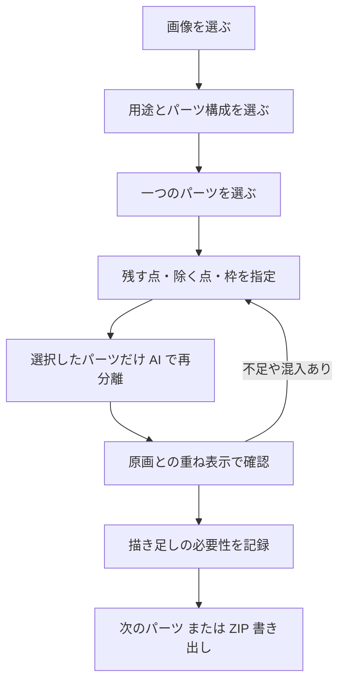

# 制作向けパーツ構成と操作画面の設計案

2026-10-09（日本時間）。オーナーの「進めて」により、構成・画面の設計が承認された。以下は実装前の案。
アプリの分類、API、コードは今回変更していない。画面案のボタン等は実装済み機能ではない。

## 目標と範囲
提供画像を参考に、上半身の瞬き・視線・小さな顔の向き・髪揺れを想定した素材準備を設計する。
動くモデルの制作は別工程。画像に存在しない画素を、切り抜き処理だけで完成させたと表示しない。
最初の実装は「見えている部分を分ける」「不足を確認する」までに絞る案。

## パーツ構成
左右はキャラクター本人の左右。正面画像ではキャラクター左が画面右にあることをラベルと図で案内する。
髪・顔・両目・体の四分類は、従来のデモとして維持する案。新しい「制作向け」構成は別のテンプレートとし、既存結果を勝手に改名・分解しない。

| グループ | 制作向けの構成 | 提供画像での注意点 | 初期試作の扱い |
|---|---|---|---|
| 髪 | 前髪、横髪 L/R、後ろ髪。必要に応じて前髪を束へ細分化 | 長い髪の不足、衣装混入、前後の曖昧さ。頭全体を hair 一枚にしない | 見える四領域を個別に指定。束の追加は将来のカスタム項目 |
| 髪飾り | リボン、ヘアピン類 | 提供画像では一方に黒いリボン、他方にピン。左右対称と決めつけない | 髪に含めるか、別に動かすかを利用者が選ぶ。初期は髪に含める案 |
| 顔・肌 | 顔の肌、首。必要に応じて耳 L/R、肩・身体の肌 | 前髪や目の下の肌は元画像では隠れている | 見える顔と首だけを抽出。不足を「描き足しが必要」と記録 |
| 目・眉 | 左右別の目。制作時は白目・瞳・上まぶた/まつ毛・必要な下まぶた・ハイライト、眉 L/R | 現モデルは両目を一度に抽出する場合がある。肌を混ぜない。まばたき用の閉じた形も別確認 | 初期は目 L/R の見える領域と眉 L/R。目の構成要素は「後で分ける」案内。これだけで瞬き素材完成とはしない |
| 口 | 上側/下側の線や唇、口内。歯・舌は必要な動きに応じて追加 | 閉じた口の画像から口内を切り抜くことはできない | 初期は口の見える領域。口開閉用の不足を表示 |
| 衣装 | トップス、ジャケット、袖 L/R。下半身を使う場合はスカート、ベルト、脚、靴等 | トップスと袖を一つの衣装として抽出すると意図が不明。肩と袖の重なりも確認 | 上半身は四領域。スカート以下は初期テンプレート対象外、元画像は保持 |

初期の制作向けテンプレート案は 15 項目:
- 前髪、横髪 L/R、後ろ髪: 4。
- 顔の肌、首: 2。
- 目 L/R、眉 L/R: 4。
- 口の見える領域: 1。
- トップス、ジャケット、袖 L/R: 4。

全項目の抽出を必須にしない。画像にない項目や動かさない項目は「今回は使わない」とする。
ジャケット本体と袖は重なりや隠れ部分を残す必要があり、完全なレイヤー分解はまだ保証しない。
作画済みの素材がある場合は、将来の「手元のパーツを取り込む」で置き換える設計候補とする。

## 状態と完成判定
各パーツは以下を別々に保持する。
- 分離状態: 未指定 / 指定済み / 処理中 / 切り抜き結果あり / 指定を変更（再実行が必要） / 処理失敗 / 今回は使わない。
- 確認状態: 未確認 / 見える部分は確認済み / 境界修正が必要。
- 描き足し状態: 未確認 / 必要 / 別途補完して確認済み / この用途では不要。

「見える部分は確認済み」は「Live2D 素材完成」と同義ではない。
最初の版は描き足し機能を持たないので「必要」の表示と説明まで。補完していない画素を自動で補完済みにしない。
取り込み検証と動きの検証は別の確認項目。静止画チェックだけで「モデル完成」と表示しない。

## 操作フロー


## スマートフォン画面
設計図: [静的な画面案](design/editor-wireframe.html)。画像は説明用の枠で、ユーザー画像を埋め込まない。

1. 上部: 「画像 → パーツ → 確認 → 書き出し」の進行、現在のモード、下書きが再読み込みで消える案内。
2. パーツ選択: 現在のパーツ名と「キャラクター左＝画面右」の表示。選択すると分類別の一覧を開く。名前の横に未確認・修正必要等を表示。
3. 中央: 原画と対象の表示。背景を市松・白・黒から切り替え、「原画を重ねる」の濃さを調整する。ズームと移動は指定モードから区別する。
4. 操作帯: 「残す点」「除く点」「枠」「移動」を文字付きで選ぶ。＋/− の形でも区別し、色だけに頼らない。
5. 下部: 「一つ戻す」「やり直す」「このパーツを再分離」。現在の結果は再分離成功まで保持する。
6. 確認欄: 「境界に修正が必要」「隠れた部分の描き足しが必要」を記録。書き出せるが、未確認・不足があることを表示する。
7. 広い画面: 左に一覧、中央に画像、右に指定と確認を配置。スマホは同じ情報を一覧の開閉と縦配置で操作する。

指で押す領域は最低 44 px を目安に設計。ピンチや移動中に点を誤追加しないよう、初期実装は明示的な「移動」モードとズームボタンを優先する。
キーボードでは対象とツールを選び、数値座標から点・枠を入力できるようにする。ダイアログは閉じた後に呼び出した操作へフォーカスを戻す。

## 追加・除外点の仕様案
- パーツごとに残す点・除く点を複数保持。最初の上限案は合計 32 点、一つの枠。
- 少なくとも残す点一つ、または枠が必要。除く点だけの依頼は拒否する。
- 正規化座標を画像基準で保持。ズーム・スクロールで点の意味や位置が変わらないようにする。
- 点の追加・削除と枠の変更を元に戻せる。初期実装は指定履歴だけで、ブラシ編集は後段。
- 指定変更は「再実行が必要」と表示。点を追加するたびに自動送信しない。
- 処理中の対象変更や画像の交換で古い結果が別パーツに反映されないよう、画像 ID・パーツ ID・指定の版を確認する。
- 再分離失敗時は既存結果を残し、古い指定の結果であることを表示する。無言で結果を消さない。
- 現在のサーバー計算中止の制約は維持して明示する。計算中止を実装するまでは「通信・結果反映の中止」と区別する。

## データと互換性の設計案
既存 API は hair/face/body/eyes と一点または一枠だけ。今回の 15 項目や複数点は現 API では受け付けないため、画面の変更だけでは実装完了にならない。
新しい API 版は以下の形を候補とする（実装時に確定）。

```json
{
  "schemaVersion": 2,
  "template": "upper-body-visible-v1",
  "partId": "hair_side_L",
  "revision": 3,
  "points": [{"x": 0.62, "y": 0.25, "label": 1}, {"x": 0.68, "y": 0.41, "label": 0}],
  "box": [0.5, 0.02, 0.82, 0.6]
}
```

label 1 は残す、0 は除く。パーツ名を SAM が認識したと解釈せず、指定からマスクを推定する。
一度に一パーツを処理する案。既存のデモと API v1 は互換性を保ち、旧結果を新テンプレートへ勝手に変換しない。
既存プロジェクト保存は未実装なので、永続保存や移行がすでに機能しているとは案内しない。

## 書き出しと重なり
- 元画像の大きさと位置を保持した PNG を使う。確認表示の拡大・余白省略は書き出しへ影響させない。
- 将来の ZIP にパーツ名、元サイズ、左右基準、確認状態、想定の重なり順を記す manifest.json を加える案。
- 重なり順は利用者が確認する。後ろ髪→身体→顔→目・眉・口→前髪等は初期目安で、すべての衣装・姿勢に固定しない。
- マスクの重なりを自動で排除しない。Live2D の動きのために重なりが必要な場合がある。
- PSD 出力は別作業。RGB/sRGB、一部品一レイヤー、名前の一意性、マスク適用等を確認し、対象 Cubism で実際に読み込めてから対応を名乗る。
- 完成モデルの moc3 出力、動作付け、SDK 表示は今回の実装候補には含めない。

## 推奨する次の実装範囲（承認待ち）
最初は既存四分類の AI 試作に、複数の残す点・除く点、指定の取り消し、選択パーツだけの再分離を追加する。
既存分類のまま髪の不足・衣装混入への効果を測定でき、15 項目・重なり管理まで同時変更する負担を抑えられる。
その後、改善結果を確認して制作向けテンプレート・確認状態・書き出し情報を実装する案。

完了条件:
- 既存デモ、個別 PNG、ZIP、画像再選択、リセットが壊れない。
- 複数点が画像の同じ位置で表示・処理される。除外点の値がサーバーに正しく渡る。
- 少なくとも残す点か枠が必要。範囲外座標・上限超過・不正なラベルをサーバー側でも拒否。
- 再分離失敗で以前の結果を失わず、指定と結果の古さが分かる。
- 追加・除外点あり/なしを同じ評価条件で比較し、悪化した場合も記録する。品質改善を事前に保証しない。
- 提供画像は従前のローカル評価条件を維持し、Git に含めない。新しい公開・外部送信・永続保存は含めない。

## 公式資料の追加確認
今回、通信を再試行して公式ページを取得できた。
- [制作フロー](https://docs.live2d.com/cubism-editor-manual/workflow/): 動かすパーツごとの切り分け、動かすと見える部分の描き足し、モデルに動きを付ける工程。
- [インポート PSD の作り方](https://docs.live2d.com/cubism-editor-manual/reimport-psd/): 一部品一レイヤー、異なるレイヤー名、マスクの適用、RGB/sRGB、不透明度と塗りの違い、消し残しの注意。
- [PSD 作成上の注意](https://docs.live2d.com/cubism-editor-manual/precautions-for-psd-data/): カラープロファイルの変換等。
- [PSD インポート](https://docs.live2d.com/cubism-editor-manual/psd-import/)、[アートメッシュ](https://docs.live2d.com/cubism-editor-manual/concept-of-artmesh/): 現行手順の参照資料を取得。
- 「素材分けについて」ページは取得時に 503。個別素材の詳細は当該ページ本文を確認したとは扱わない。

公式 PSD 文書はレイヤー内の消し残しや大きい透明領域にも注意している。アプリの元位置を保つ方針と整合するよう、書き出し元キャンバスを維持しつつ、レイヤー内部の不要画素・境界・読み込み条件を将来検証する。元位置を勝手に変える根拠にしない。

## 制作向け分類の実装記録
後続の「続けて」により、15 項目の選択・点と枠の指定・一パーツ再分離・ブラシ補正・保存を実装した。四分類は別構成として保持し、既存作業ファイル版1を読み込める。新しい状態は版2に保存する。

[実装と確認](PRODUCTION_PARTS.md)を参照。本文の確認状態・描き足し状態の記録、任意項目追加、目の構成要素の細分化、素材取り込み、PSD は未実装の設計案で、完成済み機能とは扱わない。
